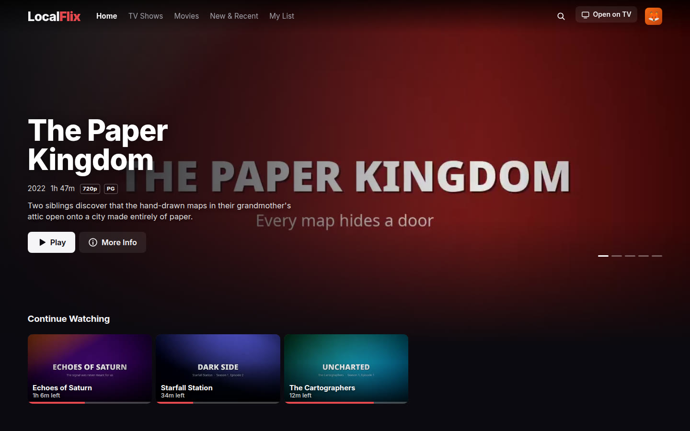
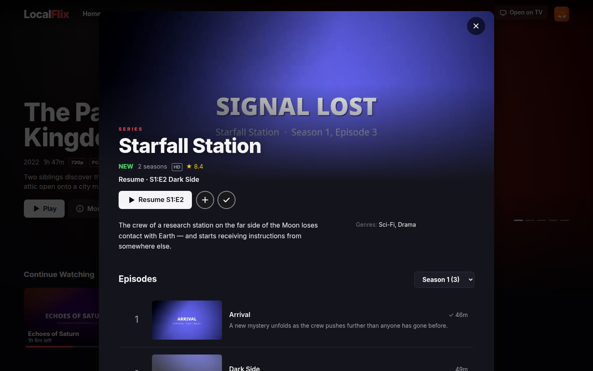
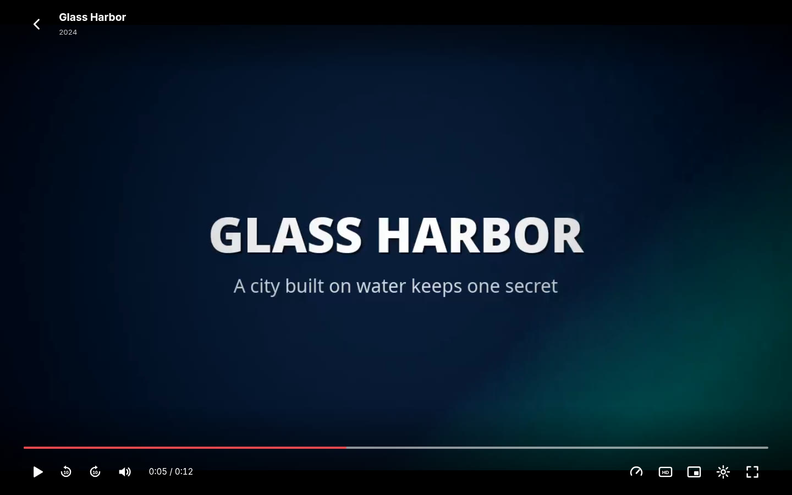
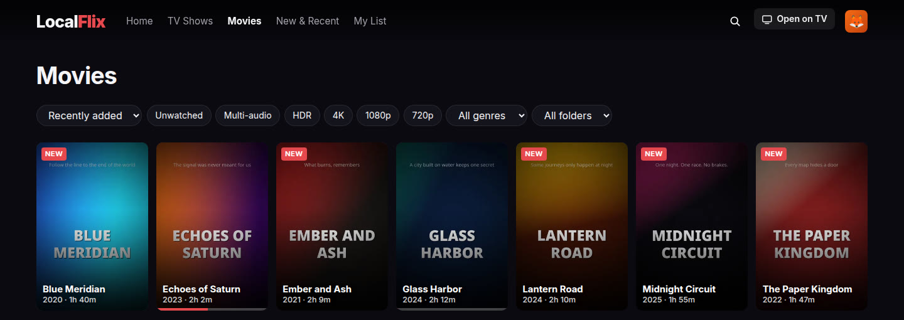
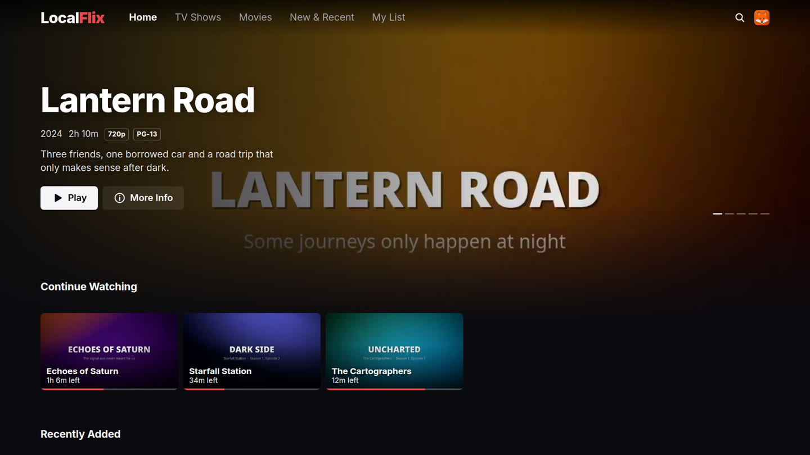
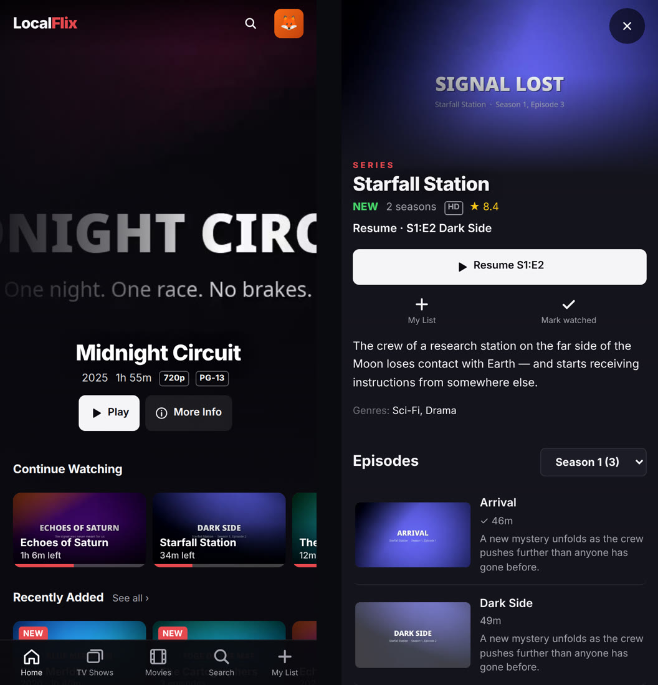
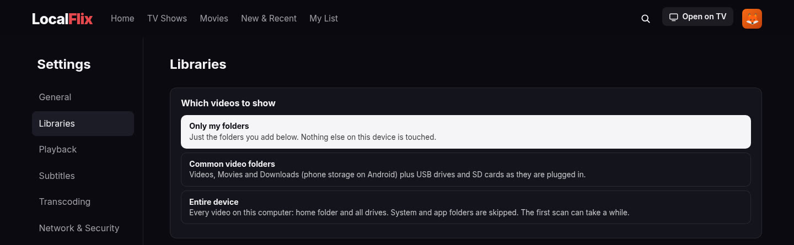

<div align="center">


# LocalFlix

**Your own streaming service for every screen at home: phones, laptops and smart TVs.<br>One Python file. No accounts, no cloud, no ads.**

[](https://github.com/MaheshTechnicals/LocalFlix/actions/workflows/ci.yml)
[](https://github.com/MaheshTechnicals/LocalFlix/releases/latest)
[](LICENSE)


[**Quick start**](#-quick-start) · [**Screenshots**](#-screenshots) · [**Features**](#-features) · [**Open on your TV**](#-open-on-your-tv) · [**FAQ**](#-faq--troubleshooting) · [**Contributing**](CONTRIBUTING.md)



</div>

---

## Why LocalFlix?

You have videos on a laptop, a PC, a Raspberry Pi or even your Android phone. LocalFlix turns that folder into a polished streaming app that every device on your Wi-Fi can open in its **web browser**, with nothing to install on them.

- 🗂️ **Drop files in a folder.** Movies, shows, seasons and episodes are recognised from file names, with posters and thumbnails.
- 📺 **Plays anything, everywhere.** MKV, HEVC, AV1, DTS, multiple audio tracks, subtitles. Files a device can't play directly are converted on the fly with ffmpeg.
- ⏯️ **Pick up where you left off** on any device: Continue Watching, next-episode countdown, seek-bar previews.
- 🎮 **TV-first.** Use your remote's arrows, OK and Back in Samsung, LG, Android TV and Fire TV browsers.
- 🔒 **Private by design.** Runs only on your home network, no telemetry. Optional password, admin PIN, kids profiles and free HTTPS.
- 🪶 **One file.** `localflix.py` uses only the Python standard library. Updating means replacing one file.

> The titles in the screenshots are fictional demo videos generated for this README.

---

## 📸 Screenshots

<table>
  <tr>
    <td width="50%"><br><sub><b>Details</b>: seasons, episodes, resume, My List</sub></td>
    <td width="50%"><br><sub><b>Player</b>: audio and subtitle tracks, speed, quality, PiP, seek previews</sub></td>
  </tr>
  <tr>
    <td width="50%"><br><sub><b>Library</b>: posters, filters by genre, resolution, HDR, unwatched</sub></td>
    <td width="50%"><br><sub><b>TV mode</b>: big type, remote-friendly focus, no mouse needed</sub></td>
  </tr>
  <tr>
    <td width="50%"><br><sub><b>Phones</b>: bottom tab bar, double-tap to seek, fullscreen landscape</sub></td>
    <td width="50%"><br><sub><b>Settings</b>: one folder, common video folders, or the whole device</sub></td>
  </tr>
</table>

---

## 🚀 Quick start

**You need:** Python **3.10 or newer**. **[ffmpeg](https://ffmpeg.org)** is strongly recommended; without it only browser-friendly MP4/WebM files play.

### 1. Get LocalFlix

Download the single file from the [latest release](https://github.com/MaheshTechnicals/LocalFlix/releases/latest):

```bash
curl -LO https://github.com/MaheshTechnicals/LocalFlix/releases/latest/download/localflix.py
```

<sub>On Windows, use PowerShell: `Invoke-WebRequest https://github.com/MaheshTechnicals/LocalFlix/releases/latest/download/localflix.py -OutFile localflix.py`. Or download the **LocalFlix-x.y.z.zip** from the release page (it includes double-click launchers), or `git clone` this repository.</sub>

### 2. Install Python and ffmpeg, then start it

<details open>
<summary><b>🪟 Windows 10 / 11</b></summary>

```bat
winget install Python.Python.3.13
```
```bat
winget install Gyan.FFmpeg
```
Close and reopen the terminal, then start LocalFlix (or double-click **`start-windows.bat`** from the zip):
```bat
py localflix.py
```
When Windows Firewall asks, allow **Private networks**.
</details>

<details>
<summary><b>🍎 macOS</b></summary>

```bash
brew install python ffmpeg
```
```bash
python3 localflix.py
```
Or double-click **`start-mac.command`**. If macOS asks, allow incoming connections for Python.
</details>

<details>
<summary><b>🐧 Linux / Raspberry Pi OS / WSL</b></summary>

```bash
sudo apt install python3 ffmpeg
```
```bash
python3 localflix.py
```
Fedora: `sudo dnf install python3 ffmpeg` · Arch: `sudo pacman -S python ffmpeg` · Alpine: `sudo apk add python3 ffmpeg`
</details>

<details>
<summary><b>🤖 Android (Termux)</b></summary>

1. Install **Termux** from [F-Droid](https://f-droid.org/packages/com.termux/). The Play Store build is outdated.
2. Install Python and ffmpeg:
   ```bash
   pkg install python ffmpeg
   ```
3. Let Termux read your phone's storage (tap **Allow**):
   ```bash
   termux-setup-storage
   ```
4. Start LocalFlix and point it at your phone's videos:
   ```bash
   python localflix.py -f ~/storage/shared/Movies -f ~/storage/shared/Download
   ```

See the [Termux guide](#-android-termux-guide) for battery and auto-start tips.
</details>

<details>
<summary><b>🐳 Docker</b></summary>

```bash
docker run -d --name localflix -p 8000:8000 \
  -v /path/to/videos:/media -v localflix-data:/data \
  ghcr.io/maheshtechnicals/localflix:latest
```
Images are built for `amd64` and `arm64` (including Raspberry Pi 4/5). On Linux, add `--network host` so the banner shows your real LAN address. To build it yourself instead, run `docker build -t localflix .`.
</details>

<details>
<summary><b>⚡ With uv</b></summary>

```bash
uv run localflix.py
```
</details>

### 3. First run

1. A short **setup wizard** asks for your media folder (default: `output/` next to the script), the port, and an optional PIN.
2. LocalFlix caches the player library and tests your hardware video encoders.
3. The terminal prints the address to open, with a **QR code** for phones:
   ```
     Open on any device on the same Wi-Fi:
       ➜  http://192.168.1.20:8000   (best)
   ```
4. Open that address on any phone, laptop or TV on the same Wi-Fi. On the computer itself, a browser opens automatically.
5. Put videos in the folder. They appear within a minute, or press **Rescan**.

---

## 📁 Naming your files

LocalFlix understands common naming styles. These layouts work best:

```text
Movies/
├── Glass Harbor (2024).mkv
├── Glass Harbor (2024)-poster.jpg        ← optional poster
└── Echoes of Saturn (2023)/
    ├── Echoes of Saturn (2023).mp4
    └── Echoes of Saturn (2023).en.srt    ← external subtitles
TV Shows/
└── Starfall Station/
    ├── poster.jpg                        ← optional show poster
    ├── Season 01/
    │   ├── Starfall Station - S01E01 - Arrival.mkv
    │   └── Starfall Station - S01E02.mkv
    └── Season 02/
        └── Starfall.Station.S02E01.1080p.WEB-DL.mkv
```

`S01E02`, `1x02`, `Season 1/Episode 2`, `Show - 102` and multi-episode files (`S01E01-E02`) are all recognised. Posters can come from `poster.jpg`, `folder.jpg`, `<name>-poster.jpg`, `fanart.jpg`, or optionally from TMDB. Otherwise LocalFlix generates thumbnails from the video.

---

## 📂 Choosing which videos LocalFlix shows

Out of the box LocalFlix indexes **one folder** only. Nothing else on the device is touched until you choose more in **Settings → Libraries → Which videos to show**, in the wizard, or with `--scope`:

| Scope | What gets indexed |
|---|---|
| **Only my folders** (default) | Just the folders you add with *Add folder* (any path, any drive) |
| **Common video folders** | Your platform's standard video folders, plus USB drives and SD cards as they are plugged in |
| **Entire device** | Everything above plus your home folder and every drive. System, app and developer folders are skipped |

<details>
<summary>Which folders count as "common" on each platform</summary>

| Platform | Folders |
|---|---|
| Windows | Videos and Downloads (real locations, including OneDrive redirection), Public Videos, OneDrive\Videos, other fixed and USB drives |
| macOS | ~/Movies, ~/Downloads, external disks in /Volumes |
| Linux | XDG Videos/Downloads (localised names work), /media/$USER, /run/media/$USER, /mnt. Under WSL: Windows Videos/Downloads |
| Android (Termux) | Movies, Download, DCIM (camera), Videos, Telegram, WhatsApp Video, SD cards. Run `termux-setup-storage` once |

*Entire device* adds the home folder (Linux/macOS), all fixed and removable drives (Windows; network and CD drives are skipped), the Windows drives under WSL, and internal storage (Android).
</details>

- **Your own folders win.** If a folder you added sits inside an auto-detected one, its files belong to your folder. Nothing is listed twice, and watch history follows the file.
- **Unplugged drives and SD cards** show as *Not connected*. Their videos are hidden, not deleted, and come back with their watch history.
- **Skipped automatically:** system and app folders (`Windows`, `Program Files`, `AppData`, `Library`, `node_modules`, `Android/data`, …), tiny files (under 2 MB by default), and `.ts` files that are really TypeScript.
- **Privacy:** with *Common* or *Entire device*, everyone who can open LocalFlix on your network sees those videos. Set a password if that matters.

---

## 📺 Open on your TV

1. Make sure the TV and the computer running LocalFlix are on the **same Wi-Fi / network**.
2. Open the TV's web browser: *Samsung Internet* (Tizen), *Web Browser* (LG webOS), *Silk* (Fire TV), *Chrome* or *TV Bro* (Android TV / Google TV).
3. Type the address from the terminal and add **`/tv`**, for example `http://192.168.1.20:8000/tv`.
4. TV mode turns on: big text, a clear focus highlight, and everything works with the remote.


| Remote key | Action |
|---|---|
| ⬆️ ⬇️ ⬅️ ➡️ | Move between items. In the player, ←/→ seek ±10 s (hold to go faster) and ↑ shows the controls |
| **OK** / Enter | Open · play · pause |
| **Back** | Close a dialog → leave the player → previous page (press twice on Home to exit) |
| ⏯ ⏹ ⏪ ⏩ ⏭ | Media keys work in the player |
| 🔴 🟢 🟡 🔵 | Subtitles · Audio · Speed · Next episode |

**Tip:** on the computer, click **Open on TV** in the top bar for a big address and a QR code. If you set a password, an admin can create a **one-time login QR**, so nobody has to type a password with a remote.

---

## ✨ Features

| Area | What you get |
|---|---|
| **Library** | Automatic movie / TV-show / episode detection, seasons, local posters or generated thumbnails, optional TMDB metadata, instant search, filters (genre, resolution, HDR, multi-audio, unwatched) |
| **Playback** | Direct Play when the device supports the file, otherwise Direct Stream (remux) or Transcode (H.264, hardware-accelerated with NVENC / QSV / VAAPI / VideoToolbox when available). Instant seeking anywhere, even while transcoding |
| **Audio** | Every audio track selectable with instant switching, preferred-language auto-pick, 5.1 → stereo downmix, optional AC3/EAC3 passthrough |
| **Subtitles** | Embedded text subs; external `.srt .vtt .ass .ssa .sub .ttml` (`Movie.en.srt`, `Movie.hi.forced.srt`, `Subs/`); image subs (PGS/VobSub) burned in. Size, colour, background, edge, position and delay settings |
| **Player** | Resume, Skip Intro/Credits (from chapters), next-episode countdown that stays fullscreen, seek-bar thumbnails, speed, quality, sleep timer, fit/fill/crop, PiP, AirPlay, Cast, lock-screen controls, stats overlay |
| **Profiles** | "Who's watching?", per-profile PIN, kids profiles with rating limits, Continue Watching and My List synced across devices |
| **Network** | Address + QR code in the terminal, auto-opens the browser, mDNS name, [fixed DuckDNS address and free HTTPS](#-fixed-address--free-https), autostart at login |
| **Security** | LAN-only by default, optional password, admin PIN, rate-limited logins, DNS-rebinding and CSRF protection, files outside your folders are never served |
| **Languages** | English and हिन्दी (Hindi). [Add yours](CONTRIBUTING.md#translations) |

### Player controls

**Keyboard:** `Space`/`K` play · `J`/`L` ±10 s · `←`/`→` ±5 s · `↑`/`↓` volume · `M` mute · `F` fullscreen · `C` subtitles · `A` audio · `[`/`]` subtitle delay · `<`/`>` speed · `N` next · `I` stats · `0–9` jump to 0–90 % · `Esc` back · `?` help

**Touch:** double-tap left/right to skip ±10 s · double-tap the middle for fullscreen · tap to show the controls · long-press for 2× speed · swipe up/down on the right for volume, on the left for brightness.

---

## 🎞️ Supported formats

| Container | Video | Audio | Subtitles |
|---|---|---|---|
| MP4, M4V, MOV, MKV, WebM, AVI, TS/M2TS, MPG, WMV, FLV, OGV, 3GP, VOB, DivX | H.264, HEVC (8/10-bit, HDR10/HLG/Dolby Vision\*), AV1, VP9, VP8, MPEG-4/Xvid, MPEG-2, VC-1, … | AAC, MP3, Opus, Vorbis, FLAC, AC3, EAC3, DTS, TrueHD, PCM, … | SRT, ASS/SSA, WebVTT, mov_text, MicroDVD, TTML, PGS, VobSub, DVB |

\*HDR is tone-mapped to SDR for screens that can't show HDR. Anything the browser can't decode is converted by ffmpeg.

---

## 🔒 Fixed address & free HTTPS

Your router may give the server a different IP every day (`192.168.0.103` today, `.107` tomorrow), which breaks bookmarks and TV shortcuts. LocalFlix can keep a free **DuckDNS** name pointed at whatever IP it has right now. You get one address that never changes, and it is also the name a free, trusted **HTTPS** certificate is issued for. No router changes are needed.

1. Go to [duckdns.org](https://www.duckdns.org), sign in, add a sub domain (e.g. `myflix`) and copy your **token**.
2. In LocalFlix open **Settings → Network & Security** and fill in *DuckDNS domain* (`myflix`) and *DuckDNS token*.
   - LocalFlix checks the IP every 2 minutes and updates the name when it changes.
   - Every device can now use `http://myflix.duckdns.org:8000`.
   - The name only points at your private Wi-Fi address, so nothing becomes reachable from the internet.
3. **HTTPS (optional).** On the server run:
   ```bash
   python3 localflix.py https
   ```
   It installs the free [acme.sh](https://github.com/acmesh-official/acme.sh) client (it asks first), proves you own the name through DuckDNS (a DNS check, no open ports), and saves a Let's Encrypt certificate for LocalFlix.
4. Restart LocalFlix and open `https://myflix.duckdns.org:8000`. You won't see a warning on any device.

What happens after that:
- **Renewal:** LocalFlix checks daily (certificates last 90 days) and loads the new certificate without a restart.
- **Opening by IP:** a device that opens LocalFlix by IP, even `192.168.0.x:8000` typed without `https://`, moves to the name automatically if the name works on that device. Turn this off with Settings → Network → *Domain redirect*.
- **Turning it off:** run `python3 localflix.py https --off` to go back to plain HTTP.

<details>
<summary>Notes and limits</summary>

- **What it needs:** `openssl` and `curl`. On Termux, run `apt install openssl curl` inside proot. On Windows, run the `https` step inside WSL, or use any ACME client and set the certificate and key paths in Settings.
- **Router blocks the name:** some routers block names that point at private addresses ("DNS rebinding protection"). Those devices simply stay on the IP address.
- **Plain IP over HTTPS:** with HTTPS on, the IP addresses still work, but the browser shows a certificate warning for them.
- **Old TVs:** some TV browsers from before about 2017 don't trust Let's Encrypt. Keep HTTPS off if you have one of these.
</details>

---

## 💻 Command line

```text
python localflix.py                         serve (first run → setup wizard)
python localflix.py serve -f DIR [-f DIR2] [--scope folders|common|all] [-p PORT] [--host IP] [--no-open] [--tv] [--no-wizard]
                          [--dev-web PATH] [--ssl-cert FILE --ssl-key FILE]
python localflix.py setup                   interactive wizard
python localflix.py doctor [--full|--json]  diagnostics (also in Settings → Advanced)
python localflix.py scan [--full]           rescan libraries, then exit
python localflix.py clear-cache [--all]     delete thumbnails, HLS segments and subtitle caches
python localflix.py service [print|install|uninstall]   start automatically at login / boot
python localflix.py https [--domain NAME --token TOKEN] [--yes] [--off]   free trusted HTTPS (DuckDNS + Let's Encrypt)
python localflix.py version
python localflix.py --selftest              built-in test suite
python localflix.py --dump-web DIR          write the embedded web files (edit, then use --dev-web DIR)
python localflix.py fixtures DIR            generate test videos with ffmpeg
```

**Environment variables:** `LOCALFLIX_HOME` (data folder), `LOCALFLIX_PORT`, `LOCALFLIX_MEDIA`, `FFMPEG_PATH`.

**Where data is stored:**

| OS | Settings and database | Cache |
|---|---|---|
| Windows | `%APPDATA%\LocalFlix` | `%LOCALAPPDATA%\LocalFlix\Cache` |
| macOS | `~/Library/Application Support/LocalFlix` | `~/Library/Caches/LocalFlix` |
| Linux / Termux | `~/.config/localflix` | `~/.cache/localflix` |

Logs are in `<settings folder>/logs`.

### Start automatically

`python localflix.py service` prints the right autostart file for your OS:

| OS | What it creates |
|---|---|
| Linux | a systemd *user* unit |
| macOS | a launchd agent |
| Windows | a Startup-folder `.bat` and a `schtasks` command |
| Android | a Termux:Boot script |

`python localflix.py service install` writes and enables it. No admin rights are needed.

---

## 🧱 Firewall fixes

- **Windows:** when the prompt appears, allow *Private networks*. If you missed it, run in an **admin** terminal:
  ```bat
  netsh advfirewall firewall add rule name="LocalFlix" dir=in action=allow protocol=TCP localport=8000
  ```
- **macOS:** System Settings → Network → Firewall → Options → allow incoming connections for Python.
- **Linux (ufw):**
  ```bash
  sudo ufw allow 8000/tcp
  ```
- **WSL2:** use the Windows host's IP and add a port proxy, or run LocalFlix directly on Windows.
- **Docker:** publish the port (`-p 8000:8000`) or use `--network host`.

`python localflix.py doctor` prints the exact command for your machine.

---

## 🤖 Android (Termux) guide

1. **Keep it running:** `sh start-termux.sh` takes a wake-lock automatically. Also open Android Settings → Apps → Termux → Battery → **Unrestricted**.
2. **Hotspot:** you can serve to a laptop or TV connected to the phone's hotspot. The banner lists every address.
3. **Start on boot:** install **Termux:Boot**, open it once, then run `python localflix.py service install`.
4. **Performance:** phones transcode slowly. Prefer MP4/H.264 files, or set *Max streaming quality* to 720p.
5. **proot-distro (Debian/Ubuntu inside Termux):** this works too. LocalFlix opens the phone's browser through Termux.

---

## ❓ FAQ / troubleshooting

<details>
<summary><b>No sound?</b></summary>

The audio is probably AC3/DTS/TrueHD, which most browsers can't decode. Install ffmpeg (see Quick start) and LocalFlix converts the audio to AAC automatically. Run `python localflix.py doctor` to confirm ffmpeg is found.
</details>

<details>
<summary><b>Buffering or slow start?</b></summary>

Try these, in order:
- Lower *Max streaming quality* (Settings → Playback).
- Enable hardware acceleration (Settings → Transcoding → *Re-detect*).
- Connect the server with a cable.

MKV files with H.264 video are remuxed and start almost instantly. Full transcodes need a reasonably fast CPU or GPU.
</details>

<details>
<summary><b>My TV can't open the page.</b></summary>

Type the raw IP address (not `localflix.local`, which many TVs can't resolve). Use `http://` unless you set up [HTTPS](#-fixed-address--free-https). Check the firewall, and check that both devices are on the same network (not a guest Wi-Fi).
</details>

<details>
<summary><b>A file doesn't show up.</b></summary>

Check that the extension is supported and the file isn't named like a release sample (`sample.mkv`, `*-sample.*`). Then press *Rescan* or run `python localflix.py scan`. Errors appear under Settings → Libraries.
</details>

<details>
<summary><b>Wrong show or episode detected?</b></summary>

Use `Show Name/Season 01/Show Name - S01E02.mkv` or `Movies/Title (2019)/Title (2019).mkv`. See [Naming your files](#-naming-your-files).
</details>

<details>
<summary><b>Subtitles out of sync?</b></summary>

Press `[` / `]`, or use the subtitles menu, to shift them by 250 ms.
</details>

<details>
<summary><b>Offline install: hls.js not cached?</b></summary>

Safari and many TVs play HLS natively. Otherwise, connect to the internet once and LocalFlix downloads and verifies hls.js automatically.
</details>

<details>
<summary><b>How do I update or uninstall?</b></summary>

- **Update:** replace `localflix.py` with the [latest release](https://github.com/MaheshTechnicals/LocalFlix/releases/latest) and restart. Your library, watch history and settings are kept.
- **Uninstall:** run `python localflix.py service uninstall` (if you enabled autostart), delete `localflix.py`, and delete the data folders listed under [Command line](#-command-line). Your videos are never modified.
</details>

---

## 🛠️ Development

Everything lives in `localflix.py`, split into `# ===== SECTION: name =====` blocks. The web UI is embedded and stays ES2019 for old TV browsers.

```bash
python3 localflix.py --selftest
```

The self-test covers the name parser, Range requests, segment tables, a 37-case playback decision matrix, subtitles, path safety, migrations, translations, and API tests against a real server with generated media.

See **[CONTRIBUTING.md](CONTRIBUTING.md)** for the architecture map, live UI editing, checks and the release process.

## 🤝 Contributing

Bug reports, device test results ("works on my LG C2!"), translations and pull requests are all welcome. Please read the [contributing guide](CONTRIBUTING.md) and the [code of conduct](CODE_OF_CONDUCT.md). For security issues, see [SECURITY.md](SECURITY.md).

## 📜 License & credits

LocalFlix is released under the **[MIT License](LICENSE)**.

- [hls.js](https://github.com/video-dev/hls.js) (Apache-2.0) is downloaded at runtime and checksum-verified.
- [FFmpeg](https://ffmpeg.org) (LGPL/GPL) is called as an external program and is not bundled.
- Optional metadata comes from [TMDB](https://www.themoviedb.org). *This product uses the TMDB API but is not endorsed or certified by TMDB.*

LocalFlix is original work. It is not affiliated with any commercial streaming service. It plays **your own** media; please respect copyright law in your country.

<div align="center"><sub>Made with ❤️ for movie nights at home.</sub></div>
